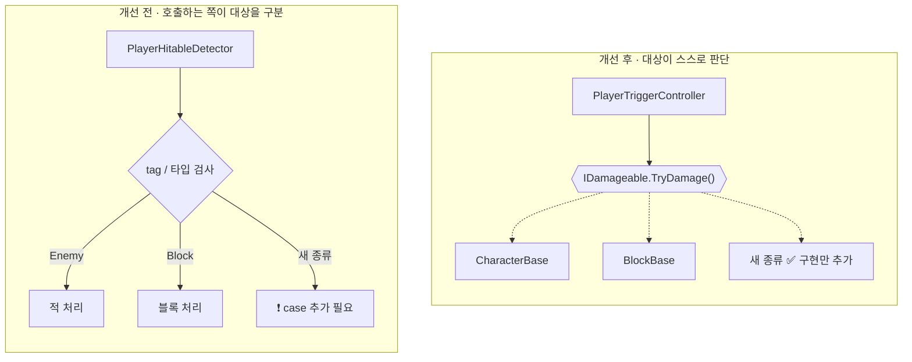
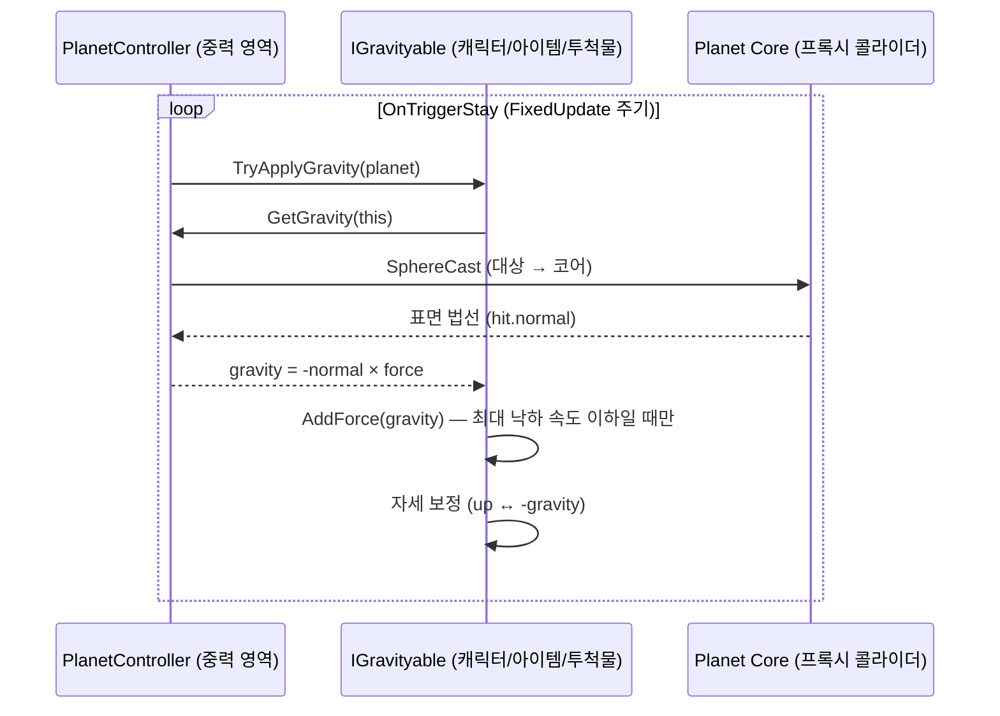
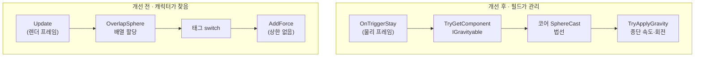

# 포트폴리오 - Unity 엔진을 활용한 3D 플랫포머 게임 개발
> 여러 형태의 행성 위로 달려 스테이지를 클리어해 나아가는 3D 플랫포머 게임

## 개요

> 독창적인 게임 시스템을 가진 ‘슈퍼 마리오 갤럭시’에 깊은 인상을 받아 Unity 엔진을 통해 재구현하여 개발
> 
> 다양한 상황과 위치에 따라 변하는 중력 시스템

| 항목 | 내용 |
| --- | --- |
| 장르 | 3D 플랫포머 |
| 개발 형태 | 1인(기획·프로그래밍) |
| 개발 기간 | 2022.12 ~ 2025.06 |
| 엔진·언어 | Unity, C# |
| 플랫폼 | Windows, Android |
| 입력 장치 | 키보드·마우스, 게임패드, 터치(가상 조이스틱) |
| 규모 | C# 스크립트 186개, 씬 4개(Title·Lobby·Tutorial·Stage) |

## 주요 개발
 
| 항목 | 핵심 | 대표 성과 |
| --- | --- | --- |
| [**오브젝트 모듈화(다형성)**](https://github.com/slshan0597/Portfolio-Development-of-a-3D-Platformer-Game-using-the-Unity#1-%EC%98%A4%EB%B8%8C%EC%A0%9D%ED%8A%B8-%EB%AA%A8%EB%93%88%ED%99%94%EB%8B%A4%ED%98%95%EC%84%B1) | 역할 인터페이스 + 베이스 클래스 + 씬 전용 서브클래스로 다형성 구현 | 인터페이스 기반 참조 비율 **3% → 72%** |
| [**중력 시스템**](https://github.com/slshan0597/Portfolio-Development-of-a-3D-Platformer-Game-using-the-Unity#2-%EC%A4%91%EB%A0%A5-%EC%8B%9C%EC%8A%A4%ED%85%9C) | 코어 콜라이더 표면 법선 기반 중력 | 오브젝트당 프레임 연산 **9회 → 2회**, GC 할당 **0건** |
| [**멀티 플랫폼 지원 및 컨트롤러 전환**](https://github.com/slshan0597/Portfolio-Development-of-a-3D-Platformer-Game-using-the-Unity#3-%EB%A9%80%ED%8B%B0-%ED%94%8C%EB%9E%AB%ED%8F%BC-%EC%A7%80%EC%9B%90-%EB%B0%8F-%EC%BB%A8%ED%8A%B8%EB%A1%A4%EB%9F%AC-%EC%A0%84%ED%99%98) | 플랫폼 판별 + 입력 장치 자동 감지 + 플랫폼별 키 매핑 | 지원 조합 **1개 → 4개**, 장치 전환 **수동 → 자동·양방향** |

- 동영상 (재생 목록): <https://www.youtube.com/playlist?list=PLhscUuAvcIkuDTdSSWKkFfHjPwHGn0bD_>

## 프로그램 구조


| 계층 | 폴더 | 역할 |
| --- | --- | --- |
| 게임 전역 | `Game/` | 싱글턴 `GameDirector`가 씬 전환 · 메뉴 · 설정 · 공용 UI · 저장 데이터를 소유, 입력 매핑도 여기서 모든 씬이 공유 |
| 씬 | `Scene/<씬>/` | `SceneBase`를 상속한 `SceneDirector`가 진입 · 퇴장 연출, 배경음, 카메라, 씬 UI 관리 |
| 씬 전용 오브젝트 | `Scene/<씬>/Object/` | 공용 클래스를 같은 이름으로 상속해 클리어 · 보상 · 체크포인트 같은 씬 규칙만 추가 |
| 공용 오브젝트 | `Object/` | 캐릭터 · 필드(Planet) · 레벨 오브젝트 · 카메라, 인터페이스로 호출 |

## 구현

### 1. 오브젝트 모듈화(다형성)

> `공통 동작은 베이스 클래스로, 속성은 인터페이스`로 분리
> 
> `인터페이스(속성) → 공용 베이스 클래스 → 구체 클래스 → 씬 전용 서브클래스`의 4단 구조로 정리, 호출하는 쪽은 대상의 구체 타입을 모른 채 인터페이스만 호출

- 소스 코드: [Scripts/Object](Scripts/Object)
- 동영상: <https://youtu.be/DAtqm6yHDps>

---

### 1-1. 상속

- 같은 타입의 오브젝트를 추가할 때마다 발생하는 중복되는 기능이나 속성들에 대해, 오브젝트의 `베이스 클래스`에 먼저 얕게 구현하고 점진적으로 확장

####  캐릭터 클래스


####  아이템 클래스


####  트랜스포터 클래스(필드간 이동)


---

### 1-2. 인터페이스

- 오브젝트가 가진 성질을 작은 인터페이스로 정의하고, 필요한 오브젝트만 골라서 구현
- 호출하는 쪽은 대상이 무엇인지 모른 채 `인터페이스만 호출`

| 항목 | 책임 | 구현 클래스 |
| --- | --- | --- |
| **공통** |
| `IGravityable` | 필드(Planet) 중력을 받고 회전 보정 | `CharacterBase`, `ThrowableBase`, `FireBallController`, `CoinController`, `HitPointItemController` |
| `IDamageable` | `[Flags]` 마스크로 받을 공격 종류를 선언하고 피격 판정 | `CharacterBase`, `BlockBase`, `ThrowableBase` |
| `IInteractable` | 플레이어가 상호작용 가능한 오브젝트 | `NonPlayerCharacterController`, `TransporterBase`, `ThrowableBase` |
| **Stage 씬** |
| `ITriggerable` | 필드 클리어 조건 | Enemy · Block · NPC |
| `IRewardable` | 필드 클리어 보상 | Transporter · Goal |
| `ICheckPointable` | 재시작 지점 제공 | Transporter(Launcher) · Planet |

#### 공통 인터페이스


#### 스테이지 씬의 오브젝트 인터페이스


#### 스테이지 씬의 레벨 클리어 프로세스


---

### 1-3. 개선 내용


| 관점 | 개선 전(타입 · 태그 의존) | 개선 후(인터페이스) |
| --- | --- | --- |
| **확장성** | 새 오브젝트가 생길 때마다 호출하는 쪽 코드에 `case` 추가 | `IDamageable` 등만 구현하면 호출하는 쪽은 **수정 없음** |
| **분기** | `tag == "Player"`, 타입별 `switch`가 종류만큼 증가 | "할 수 있는 일"만 호출 → 분기 자체가 사라짐 (태그 비교 **7곳 → 0곳**) |
| **결합도** | 공격 · 피격, 행성 · 대상이 서로의 구체 클래스를 알아야 함 | 서로 인터페이스만 알면 됨 → 한쪽 수정이 다른 쪽에 영향 없음 |
| **안정성** | 수정 지점이 많아 기존 기능 회귀 위험 | 수정 범위가 새 클래스 하나로 한정 |
 


---

### 2. 중력 시스템

> 필드(Planet)에 대해 오브젝트는 위치에 따라 고유한 중력을 받아야 하므로, Physics의 Gravity 속성의 글로벌 설정 대신 `별도의 Gravity 속성`을 구현



#### 소스 코드: [Scripts/Object/PlanetController.cs](Scripts/Object/PlanetController.cs), [Scripts/Object/ObjectBase.cs](Scripts/Object/ObjectBase.cs)
#### 동영상: <https://youtu.be/bSYdc5tvh7Y>

---

### 2-1. 중력(방향) 계산

- 기본적으로 중력은 필드의 코어를 향하지만, `코어와 오브젝트를 잇는 직선과 만나는 지면의 법선`을 구하는 과정을 추가하여 그 역방향을 오브젝트의 Gravity 속성에 부여
- Gravity 속성으로 오브젝트에 힘을 가함과 동시에 벡터의 방향을 기준으로 오브젝트를 회전

#### 중력을 구하는 과정에 대한 평면도


#### 캐릭터별 중력이 적용된 결과


---

### 2-2. 필드(Planet)에 따른 프로퍼티

- 필드의 지형을 단순한 구 형태만 사용하는 것 뿐만 아니라, `다양한 지형(형태)에 대응하는 중력 계산식과 프로퍼티` 를 구현
- 내부가 비어있는 경우, 역으로 코어에서 오브젝트로 향하는 직선이 지면에 교차할 때의 법선을 구하는 방식으로 변경
- 원기둥 형태의 경우, 코어를 관통하는 하나의 축에 대하여 오브젝트가 투영된 위치를 임시 코어로 지정하여, 그 임시 코어를 기준으로 동일한 방식으로 적용

#### 플래닛(지형) 클래스의 중력 프로퍼티


#### Core Type 속성이 Line인 지형의 평면도


#### Gravity Direction 속성이 Outward인 지형의 평면도


(좌- Core Type이 Point인 평면도 / 우- Core Type이 Line 인 평면도)

### 2-3. 개선 내용

1) 캐릭터가 필드를 탐색 -> 필드가 캐릭터를 탐색하는 구조로 변경

| 개선 전 | 개선 후 |
| --- | --- |
| 캐릭터마다 내부의 `Update`에서 `OverlapSphere`로 필드를 탐색 (매 프레임 배열 할당) | 필드 트리거의 `OnTriggerStay`가 영역 안 `IGravityable`에게만 중력 전달 |
| 태그(`"Player"`/`"Enemy"`) `switch`로 콜라이더를 다르게 조회 → 대상 종류마다 필드 코드 수정 | 대상이 `radius`·`rigidbody` 등을 인터페이스로 노출 → 대상만 추가 |
 


2) 플레이어의 필드간 이동에 대한 Rigidbody 충돌 문제

- 씬의 모든 필드를 활성화 -> 플레이어가 있는 영역의 필드만 활성화
- 활성화된 필드에 있는 모델만 그림자를 렌더링하고 캐릭터들을 활성화, 멀리 있는 행성은 그림자 연산과 AI가 쉬도록 하여 부하를 감소
- 트랜스포터(Launcher)는 스플라인 궤적을 따라 플레이어를 다른 필드로 이동시키며, 이동 중에는 Rigidbody를 Kinematic으로 전환
- 이때 Kinematic 전환으로 인해 발생하는 Trigger Exit 이벤트가 필드를 잘못 비활성화하지 않도록, 직전 Kinematic 상태를 기억해 해당 이벤트를 무시함

| 개선 전 | 개선 후 |
| --- | --- |
| 트랜스포터가 플레이어를 `isKinematic = true`로 바꾸면 `OnTriggerExit` 발생 → 필드 비활성화(그림자 꺼짐, 캐릭터(Enemy) 정지) | 마지막으로 본 kinematic 상태를 기억해 **물리 상태 전환으로 생긴 Exit는 무시** |

```csharp
protected virtual void OnTriggerExit(Collider other)
{
    if (other.isTrigger || !other.TryGetComponent(out IPlayerController player)) return;
    if (playerIsKinematic != player.rigidbody.isKinematic)
    {
        playerIsKinematic = player.rigidbody.isKinematic;   // 실제 이탈이 아님
        return;
    }
    SetEnable(false, player);
}
```

---

### 3. 멀티 플랫폼 지원 및 컨트롤러 전환

> 키보드 · 게임패드 · 터치(Mobile 한정)를 실행 중 자동 전환하고, 키 매핑을 행동 × 플랫폼 × 입력 장치 3차원으로 관리
>
> 모든 UI는 `UIBase`를 상속하며, 해상도 비율(16:9 / 4:3)을 변경하면 `CanvasScaler`의 기준 축을 바꿔 모든 UI가 잘리지 않게 비율을 계산하여 적용

### 지원 범위
 
| 플랫폼 | 키보드·마우스 | 게임패드 | 터치(가상 조이스틱) |
|---|:---:|:---:|:---:|
| Windows | ✅ | ✅ | — |
| Android | — | ✅ | ✅ |

#### 소스 코드: [Scripts/Game/Menu/Setting/Details/Control](Scripts/Game/Menu/Setting/Details/Control), [Scripts/UIBase.cs](Scripts/UIBase.cs)
#### 동영상: <https://youtu.be/cM-nUX7hS6k>

---

### 3-1. 감지 흐름

- 플랫폼과 입력 장치에 대해, 컨트롤 관리자를 통해 식별한 뒤 입력에 대응하는 맵핑(Key)으로 변환
- 변환과 동시에 연결된 모든 UI에 대해, UI의 레이블과 단축 키 입력 등을 해당 맵핑으로 전환하여 표시

```csharp
// ControlSettingManager — 눌린 키로 장치를 판정 (기존 Input Manager에는 장치 연결 이벤트가 없음)
switch (Application.platform)
{
    case RuntimePlatform.Android:
        if (Input.touchCount > 0) type = State.Touch;
        else foreach (KeyCode key in Enum.GetValues(typeof(KeyCode)))
            if (Input.GetKeyDown(key) && key.ToString().Contains("Joystick")) { type = State.Joystick; break; }
        break;
 
    default:
        foreach (KeyCode key in Enum.GetValues(typeof(KeyCode)))
            if (Input.GetKeyDown(key)) { type = key.ToString().Contains("Joystick") ? State.Joystick : State.Keyboard; break; }
        break;
}
if (state != type) SetState(type);
```

#### 입력에 따른 UI 전환 프로세스


#### 입력에 따른 UI 전환 결과


(좌- Windows 플랫폼 + Keyboard 입력 / 중- Windows 플랫폼 + Gamepad 입력 / 우- Android 플랫폼 + Touch 입력)

---

### 3-2. 입력 추상화

- `IPlayerInputManager`는 장치와 무관한 **의도(Intent)** 만 노출, 플레이어는 장치를 모름
- 플레이어 로직은 `jumpKeyPressed`만 확인하고, 그 값이 스페이스바인지, 패드 A 버튼인지, 화면 터치인지는 알 필요가 없음
 
```csharp
public interface IPlayerInputManager
{
    Vector3 moveDirection      { get; }   // 정규화된 이동 입력
    Vector2 cameraAxis         { get; }   // 카메라의 방향
    bool    jumpKeyPressed     { get; }
    bool    crouchKeyPressed   { get; }
    bool    hipDropKeyPressed  { get; }
    bool    attackKeyPressed   { get; }
    bool    interactKeyPressed { get; }
}
```
 
```csharp
// PlayerInputManager.cs — 현재 입력 상태에 따라 소스만 교체
switch (controlSetting.state)
{
    case ControlState.Touch:
        var buttons = virtualJoystick.root.main.action.buttons;
        jumpKeyPressed = buttons[MainState.Jump].pressedDown;
        ...
        break;
 
    default:   // Keyboard, Joystick — 플랫폼 · 장치별 매핑된 KeyCode 사용
        jumpKeyPressed = Input.GetKeyDown(controlSetting.GetKey(MainState.Jump));
        ...
        break;
}
```

---

### 3-3. 플랫폼 · 장치별 키 매핑과 재설정

- 키 매핑은 **행동 → 플랫폼 → 장치 → KeyCode** 의 3단 구조로 저장
-  인스펙터에서 편집할 수 있도록 직렬화 가능한 제네릭 딕셔너리 `SimpleData<TKey, TValue>`를 직접 만들어 사용
 
```
Jump
 ├─ WindowsPlayer ─┬─ Keyboard : Space
 │                 └─ Joystick : JoystickButton0
 └─ Android ───────── Joystick : JoystickButton0
```
 
```csharp
// 저장 키 형식: "{설정종류}_Character_{행동}_{플랫폼}_{장치}"
string  key   = $"{this.type}_Character_{mappingsType}_{mappingType}_{type}";
KeyCode value = Enum.TryParse(PlayerPrefs.GetString(key), out KeyCode result) ? result : element.value;
```
 
- 설정 메뉴에서 키를 재설정할 때는 **현재 장치에 맞는 키만 허용**
- 키보드 모드에서는 패드 버튼을, 패드 모드에서는 키보드 키를 무시하며, Android에서 화면을 터치하면 재설정을 취소
- 카메라 감도와 상하 · 좌우 반전도 함께 저장

---

### 3-4. 부가 기능
- 입력 장치가 Gamepad일 경우, 마우스 입력 없이도 메뉴 조작이 가능하도록 각 UI 마다 `내비게이션(Select) 기능을` 별도로 구현
- 플랫폼이 Android일 경우, Touch 입력에 따른 플레이어의 조작을 위한 `Virtual Gamepad(UI)` 기능 추가

```csharp
protected virtual void SetState(State type)
{
    state = type;
 
    game.SetCursorVisible(CursorVisibleEventType.ControllerChange, type != State.Joystick);
 
    foreach (var ui in connectedUI) ui.Set();   // 버튼 라벨, 가상 조이스틱 표시 여부 등 갱신
 
    switch (state)
    {
        case State.Joystick: connectedUI.current?.SelectFirstSelectable();    break;  // 패드 UI 내비게이션
        default:             EventSystem.current.SetSelectedGameObject(null); break;
    }
}
```

#### Gamepad 입력 장치에 대한 내비게이션(Select) 기능


#### Android 플랫폼에 대한 가상 게임패드


--- 

### 3-5. 개선 내용

1) 커서 표시 및 충돌

| 개선 전 | 개선 후 |
| --- | --- |
| 메뉴와 패드 모드가 각자 `Cursor.visible` 변경 → 패드 모드에서 메뉴를 닫으면 커서가 다시 나타남 | 이유별 표시 여부를 보관하고 **모두 `true`일 때만** 표시 → 호출 순서와 무관 |
| 일시정지할 때 현재 씬 이름을 확인해 커서를 직접 켜고 끔 → 패드를 쓰는 중에도 메뉴를 열면 커서가 나타났고, 씬이 늘어날 때마다 분기를 추가해야 함 | "메뉴 열림", "장치 변경" 등 이벤트별로 표시 요청만 등록하고, **모든 요청이 표시를 원할 때만** 커서를 보여줌 → 패드 사용 중에는 메뉴를 열어도 커서가 나타나지 않음 |

```csharp
public virtual void SetCursorVisible(CursorVisibleEventType type, bool visible)
{
    cursorVisibles[type] = visible;
 
    bool result = true;

    foreach (bool value in cursorVisibles.Values) result &= value;
 
    Cursor.visible   = result;
    Cursor.lockState = (controlSetting.state == ControlState.Keyboard && !result) ? CursorLockMode.Locked
                                                                                   : CursorLockMode.None;
}
```

2) 컨트롤 설정(매핑) 중, 컨트롤러 변경 시 충돌

| 개선 전 | 개선 후 |
| --- | --- |
| 키 재지정 대기 중 패드 버튼 → 자동 감지가 먼저 반응해 매핑 대상이 엇갈림 | 키 입력 대기 상태(`WaitingForInput`)를 추가 → 해당 상태에서는 장치 판정을 건너뜀 |

```csharp
protected virtual IEnumerator DetectJoystick()
{
    while (!Input.anyKeyDown) yield return null;

    IConfirmUIController confirmUI = menu.game.ui.confirm;

    // 설정 창(UI)에서 키 설정 중에 타 입력 방식이 감지될 경우, UI 등의 혼선 방지를 위해 스킵
    if (confirmUI.state == ConfirmUIController.State.WaitingForInput) goto Skip;

    State type = state;

    switch (Application.platform)
    {
        ...
    }
}
```

## 개발 히스토리

| 버전 | 주요 변화 |
|---|---|
| | **프로토 타입 개발** |
| 2022.12 | 캐릭터 이동 · 카메라 기능 구현 |
| 2023.01 | 중력 시스템 구현 및 캐릭터에 적용 |
| 2023.02 | 트랜스포터(필드간 이동) · 적 AI · 캐릭터 공격 기능 구현 |
| | **프로젝트 설계 구체화 및 세부 구현** |
| 2023.04 | 기존의 캐릭터 설계(및 구현)을 폐기하고 새로 재구현 |
| 2023.08 | 각종 오브젝트(적 AI · 트랜스포터 · 블록 등) 구현, 오브젝트의 모듈화(베이스 클래스 + 인터페이스 구조) |
| 2023.12 | 타이틀 · 로비 · 스테이지 씬 구현, 캐릭터의 가챠(데이터만) 기능 추가 |
| | **프로젝트 전체 재구성 및 리팩토링** |
| 2024.04 | 캐릭터 가챠 기능 삭제(캐릭터 하나로 단일화), 모든 씬의 구조(패키지)와 함수의  |
| 2024.04 | 이펙트 · 음성 모듈 분리, 트랜스포터 오브젝트 계층화 |
| 2024.06 | `Object/` · `Scene/` 분리, 씬 디렉터 베이스 클래스, UIBase 통합 |
| 2024.12 | 설정 메뉴 재작성(조작 키 재설정, 그래픽 옵션), 세이브 시스템 개편 |
| 2025.01 | 가상 조이스틱 |
