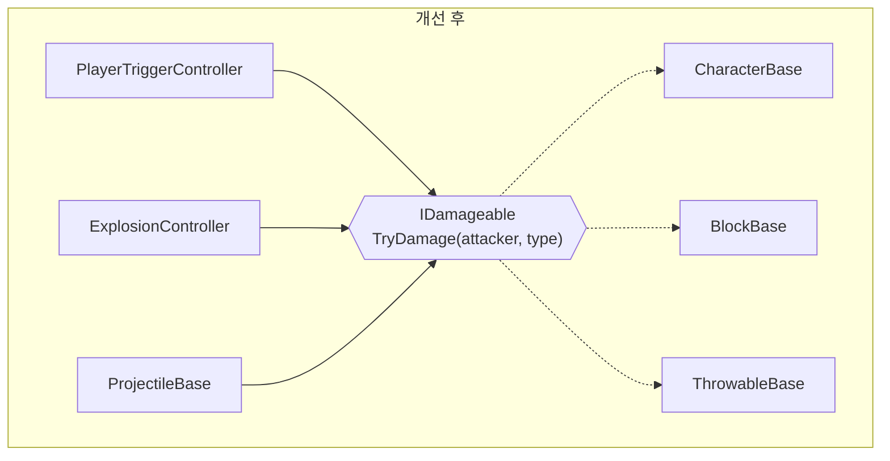

# 포트폴리오 - Unity 엔진을 활용한 3D 플랫포머 게임 개발

- 독창적인 게임 시스템을 가진 ‘슈퍼 마리오 갤럭시’에 깊은 인상을 받아 Unity 엔진을 통해 재구현하여 개발
- 다양한 상황과 위치에 따라 변하는 중력 시스템

## 개요

| 항목 | 내용 |
| --- | --- |
| 장르 | 3D 행성 플랫포머 |
| 개발 형태 | 1인 개인 프로젝트 (기획·프로그래밍) |
| 개발 기간 | 2022.12 ~ 2025.06 |
| 엔진·언어 | Unity, C# |
| 플랫폼 | Windows, Android |
| 입력 장치 | 키보드·마우스, 게임패드, 터치(가상 조이스틱) |
| 규모 | C# 스크립트 186개, 씬 4개(Title·Lobby·Tutorial·Stage) |

## 주요 개발
 
| 항목 | 핵심 | 대표 성과 |
| --- | --- | --- |
| [**오브젝트 모듈화**](https://github.com/slshan0597/Portfolio-Development-of-a-3D-Platformer-Game-using-the-Unity/blob/main/README.md#1-%EC%98%A4%EB%B8%8C%EC%A0%9D%ED%8A%B8-%EB%AA%A8%EB%93%88%ED%99%94-%EB%8B%A4%ED%98%95%EC%84%B1) | 역할 인터페이스 + 베이스 클래스 + 씬 전용 서브클래스로 다형성 구현 | 인터페이스 기반 참조 비율 **3% → 72%**, 감지 스크립트 **5개 → 1개** |
| [**중력 시스템**](https://github.com/slshan0597/Portfolio-Development-of-a-3D-Platformer-Game-using-the-Unity/blob/main/README.md#2-%EC%A4%91%EB%A0%A5-%EC%8B%9C%EC%8A%A4%ED%85%9C) | 코어 콜라이더 표면 법선 기반 중력 | 오브젝트당 프레임 연산 **9회 → 2회**, GC 할당 **0건**, 행성 형태 **5종** 지원 |
| [**멀티 플랫폼 지원 및 컨트롤러 전환**](https://github.com/slshan0597/Portfolio-Development-of-a-3D-Platformer-Game-using-the-Unity/blob/main/README.md#3-%EB%A9%80%ED%8B%B0-%ED%94%8C%EB%9E%AB%ED%8F%BC-%EC%A7%80%EC%9B%90-%EB%B0%8F-%EC%BB%A8%ED%8A%B8%EB%A1%A4%EB%9F%AC-%EC%A0%84%ED%99%98) | 플랫폼 판별 + 입력 장치 자동 감지 + 플랫폼별 키 매핑 | 지원 조합 **1개 → 4개**, 장치 전환 **수동 → 자동·양방향** |

- 동영상 (재생 목록): <https://www.youtube.com/playlist?list=PLhscUuAvcIkuDTdSSWKkFfHjPwHGn0bD_>

## 프로그램 구조


## 구현

### 1. 오브젝트 모듈화 (다형성)

> "오브젝트가 **무엇인지**" 묻던 코드를 "오브젝트가 **무엇을 할 수 있는지**" 묻는 코드로 전환
> 
> "역할 인터페이스 → 공용 베이스 클래스 → 구체 클래스 → 씬 전용 서브클래스"의 4단 구조로 정리, 호출하는 쪽은 대상의 구체 타입을 모른 채 인터페이스만 호출

- 소스 코드: [Scripts/Object](Scripts/Object)
- 동영상: <https://youtu.be/DAtqm6yHDps>

---

### 상속

- 같은 타입의 오브젝트를 추가할 때마다 발생하는 중복되는 기능이나 속성들에 대해, `오브젝트의 기반 클래스`에 먼저 얕게 구현하고 점진적으로 확장

####  캐릭터 클래스


####  아이템 클래스


####  트랜스포터 클래스


---

### 인터페이스

- 여러 계층을 가로지르는 6개의 역할 인터페이스가 다형성의 중심, 호출하는 쪽은 대상이 무엇인지 모른 채 인터페이스만 호출

| 항목 | 책임 | 구현 클래스 |
| --- | --- | --- |
| `IGravityable` | 필드(Planet) 중력을 받고 회전 보정 | `CharacterBase`, `ThrowableBase`, `FireBallController`, `CoinController`, `HitPointItemController` |
| `IDamageable` | `[Flags]` 마스크로 받을 공격 종류를 선언하고 피격 판정 | `CharacterBase`, `BlockBase`, `ThrowableBase` |
| `IInteractable` | 대화 · 텔레포트 | `NonPlayerCharacterController`, `TransporterBase`, `ThrowableBase` |
| `ITriggerable` | 처치 · 파괴 시 필드 클리어 조건 통지 | Stage 씬의 적 · 블록 · NPC |
| `IRewardable` | 클리어 보상으로 등장 | Stage 씬의 텔레포트 · 골 |
| `ICheckPointable` | 재시작 지점 제공 | Stage 씬의 텔레포트 · 필드 |

#### 공통 인터페이스


#### 스테이지 씬의 오브젝트 인터페이스 (기존 인터페이스 상속)


#### 스테이지 씬의 레벨 클리어 프로세스 (트리거 추가)


---

### 문제 해결
 
대상별로 나뉜 플레이어 공격 감지기 → <code>IDamageable</code> 하나로 통합

**개선 전 (문제점)**
- `PlayerHitableDetector`, `PlayerWallDetector`, `PlayerInteractableDetector`, `PlayerOtherCharacterDetector` + 공통 부모, 총 5개 파일이 "무엇을 맞혔는가"까지 구분
- 던지기 상자 · 블록처럼 맞을 수 있는 대상이 늘 때마다 감지 로직 수정 필요
  
**개선 후 (개선 방법)**
- 판단 책임을 **맞는 쪽**으로 이동: `IDamageable`이 `[Flags]` 마스크로 받을 공격을 선언하고, `TryDamage()`가 수락 여부를 `bool`로 반환
- 공격하는 쪽은 결과에 따라 반응, 폭발 · 투사체도 같은 방식으로 사용


 
```csharp
// 트리거 오브젝트 이름("Foot", "Normal" …)을 공격 종류로 해석 → 같은 스크립트를 발·몸에 재사용
type = Enum.TryParse(name, out DamageType _type) ? _type : DamageType.None;
 
if (!target.TryDamage(player.transform, type)) return;   // 마스크에 없는 공격이면 false
switch (type) {
    case DamageType.Normal: camera.Shake(CameraShakeType.Medium); break;  // 공격 성공 시 화면 흔들림
    case DamageType.Foot:   player.Jump(JumpState.Bounce);        break;  // 밟으면 튕겨 오름
}
```

---

### 성과


---

### 2. 중력 시스템
- 필드(Planet)에 대해 각 `오브젝트는 위치에 따라 고유한 중력`을 받아야 하므로, Physics의 Gravity 속성의 글로벌 설정 대신 별도의 Gravity 속성을 구현

#### 소스 코드: [Scripts/Object/PlanetController.cs](Scripts/Object/PlanetController.cs), [Scripts/Object/ObjectBase.cs](Scripts/Object/ObjectBase.cs)
#### 동영상: <https://youtu.be/bSYdc5tvh7Y>

---

- 기본적으로 중력은 필드의 코어를 향하지만, `코어와 오브젝트 사이의 직선과 교차하는 지면의 법선`을 구하는 과정을 추가하여 그 역을 오브젝트의 Gravity 속성에 부여
- Gravity 속성으로 오브젝트에 힘을 가함과 동시에 벡터의 방향을 기준으로 오브젝트를 회전시키는 방법으로 구현

#### 2-1) 중력을 구하는 과정에 대한 평면도


#### 2-2) 캐릭터별 중력이 적용된 결과


---

- 필드의 지형을 단순한 구 형태만 사용하는 것 뿐만 아니라, `다양한 지형(형태)에 대응하는 중력 계산식과 프로퍼티` 를 구현
- 내부가 비어있는 경우, 역으로 코어에서 오브젝트로 향하는 직선이 지면에 교차할 때의 법선을 구하는 방식으로 구현
- 원기둥 형태의 경우, 코어를 관통하는 하나의 축에 대하여 오브젝트가 투영된 위치를 임시 코어로 지정하여, 그 임시 코어를 기준으로 동일한 방식으로 구현

#### 2-3) 플래닛(지형) 클래스의 중력 프로퍼티


#### 2-4) Core Type 속성이 Line인 지형의 평면도


#### 2-5) Gravity Direction 속성이 Outward인 지형의 평면도


(좌- Core Type이 Point인 평면도 / 우- Core Type이 Line 인 평면도)

---

### 3. 멀티 플랫폼 지원 및 컨트롤러 전환
- `Windows와 Android 플랫폼`에 대하여, 빌드 환경이 달라도 컴파일과 빌드가 가능하도록 플랫폼(Type)에 따른 조건을 추가하는 방식으로 소스 코드를 구현
- 플랫폼과 별개로, 기본 입력 장치(Windows -> Keyboard, Android -> Touch) 외에 별도의 `컨트롤러(Gamepad) 연결 시 전환` 기능 구현

#### 소스 코드: [Scripts/Game/Menu/Setting/Details/Control](Scripts/Game/Menu/Setting/Details/Control), [Scripts/UIBase.cs](Scripts/UIBase.cs)
#### 동영상: <https://youtu.be/cM-nUX7hS6k>

---

- 플랫폼과 입력 장치에 대해, 컨트롤 관리자를 통해 식별한 뒤 입력에 대응하는 맵핑(Key)으로 변환
- 변환과 동시에 연결된 모든 UI에 대해, UI의 레이블과 단축 키 입력 등을 해당 맵핑으로 전환하여 표시

#### 3-1) 입력에 따른 UI 전환 프로세스


#### 3-2) 입력에 따른 UI 전환 결과


(좌- Windows 플랫폼 + Keyboard 입력 / 중- Windows 플랫폼 + Gamepad 입력 / 우- Android 플랫폼 + Touch 입력)

---

- 입력 장치가 Gamepad일 경우, Selectable UI 간의 선택과 이동이 가능하도록 각 UI 마다 `Select 기능을` 별도로 구현
- 플랫폼이 Android일 경우, Touch 입력에 따른 플레이어의 조작을 위한 `Virtual Gamepad(UI)` 기능 추가

#### 3-3) Gamepad 입력 장치에 대한 Select 기능


#### 3-4) Android 플랫폼에 대한 Virtual Joystick


